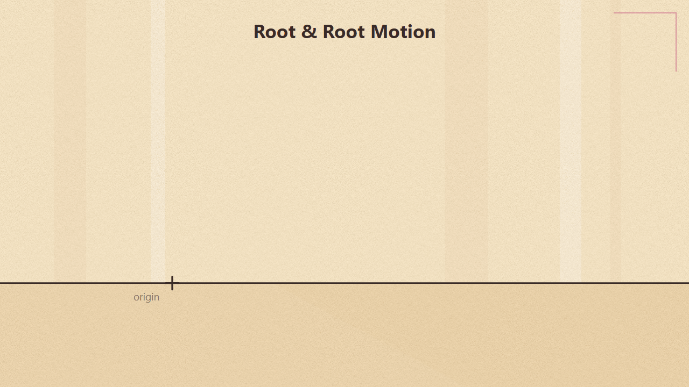
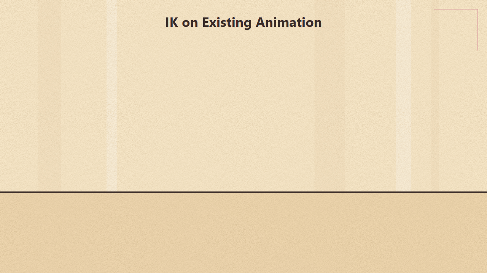
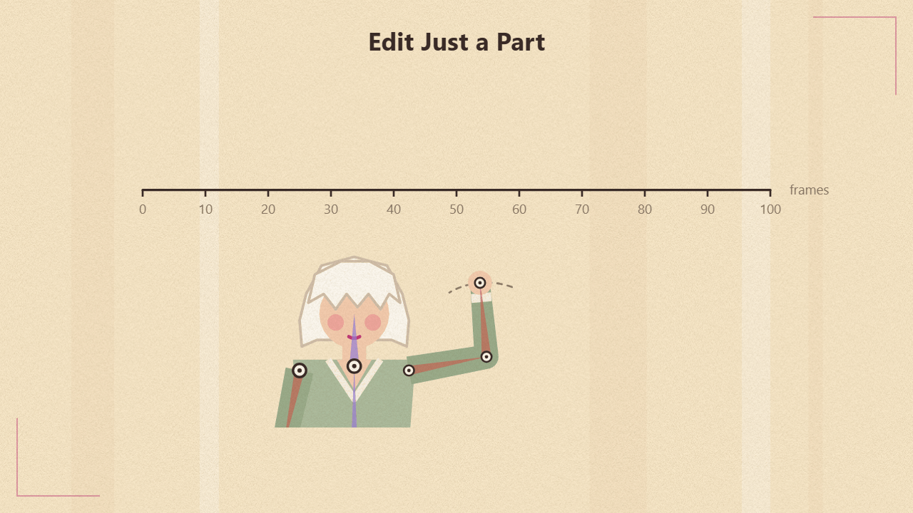

# MayaMixamoAssist

> **Student work.** This is a student project, shared for learning and non-commercial use.
> The animations and character models shown in the demo video are **not** mine — see
> [Third-party content](#third-party-content).
>
> **This project is vibe-coded.** The code, tests and explainer animations were written
> by an AI coding assistant (Claude Code) through conversation. The author designed the
> features and workflow, directed the work, and tested the plug-in in Maya.

**Demo video:** [watch on Google Drive](https://drive.google.com/file/d/1OQWvfce-O8TXCdGhohfJKjc74lHyTWDo/view?usp=sharing) (requires an NYU Google account)

A Maya plug-in that prepares Mixamo animations for Unreal Engine: add a root bone,
turn in-place motion into root motion, and fix hands and feet with temporary IK —
editing just a range of frames and blending back into the original animation.

Built and tested with **Maya 2027** (Python 3, Maya Python API 2.0).

> Not affiliated with or endorsed by Adobe or Mixamo. This repository contains no
> Mixamo or Sketchfab files — only code and original explainer graphics.

## How it works

| Root & root motion | IK on an existing animation | Edit just a range |
|---|---|---|
|  |  |  |

More explainer animations: open `presentation/index.html` in a browser.

## Features

All tools live in the **Mixamo Tools** menu in Maya's main menu bar.

### Root

| Menu item | What it does |
|---|---|
| **Add Root Joint** | Adds a `root` joint on the ground above the skeleton's top joint (e.g. `mixamorig:Hips`). Animation is not changed. |
| **Add Follow Root...** | Same root, baked to follow the pelvis on the axes you tick (translate X/Y/Z, rotate X/Y/Z; default: translate X and Z, so it slides on the ground). The pelvis is re-baked so the character's motion is unchanged — this is root motion for Unreal. |
| **Move Pelvis to Origin** | Shifts the whole animation so the pelvis is at world `(0, height, 0)` on the first frame. Works with no root, a static root or a follow root. |

### Limb IK

| Menu item | What it does |
|---|---|
| **Build Limb IK...** | Temporary IK controls on the arms and/or legs (hand/foot control + elbow/knee pole). With no edits the rig reproduces the original animation exactly, including joint twist. Controls can be relative to the chest, pelvis or world. |
| **New Edit Layer...** | Select IK controls and a frame range (shift-drag in the time slider); creates an additive animation layer whose weight fades in and out (ease or linear). Pose the controls and key them (`S`) — only that range changes. Mute the layer to compare with the original. |
| **Bake IK and Remove...** | Bakes the result onto the skeleton — only the edited ranges (all other keys stay exactly as they were) or the whole animation — and deletes the rig and edit layers. |
| **Remove IK (Discard Edits)** | Deletes the rig and edit layers; the original animation comes back untouched. |

Every tool is a single undo step.

**Choosing the skeleton:** with nothing selected, the only skeleton in the scene is used.
Otherwise select any joint of it, its group, or the skinned mesh.

## Install

1. Copy or clone this repository.
2. Point Maya at the `plug-ins` folder. Add this line to `Documents/maya/2027/Maya.env`
   (adjust the path), then restart Maya:

   ```
   MAYA_PLUG_IN_PATH=D:\path\to\MayaMixamoAssist\plug-ins
   ```

   Or skip this step and load the file directly with *Browse...* in the Plug-in Manager.
3. **Windows › Settings/Preferences › Plug-in Manager**, tick **Loaded** (and **Auto load**)
   for `mixamo_root_tool.py`.

After editing the code, untick and re-tick **Loaded** to reload it.

## Typical workflow

1. Import a Mixamo FBX (download it *without* "In Place" for walks and runs).
2. **Move Pelvis to Origin**, then **Add Follow Root...** (or **Add Root Joint** for in-place clips).
3. Optional: **Build Limb IK...** → **New Edit Layer...** for each fix → **Bake IK and Remove...**
4. Export FBX and import into Unreal; enable *Root Motion* on the animation sequence.

## Notes

- Limb joints must be driven by plain keyframes. If a limb joint is in one of your own
  animation layers, merge that layer into BaseAnimation first (the tool tells you which).
- Joint names are matched on the Mixamo names (`LeftArm`, `LeftForeArm`, `LeftHand`,
  `LeftUpLeg`, `LeftLeg`, `LeftFoot`, …), with or without the `mixamorig:` namespace.

## Tests

Headless tests run with Maya's own Python interpreter:

```
"C:\Program Files\Autodesk\Maya2027\bin\mayapy.exe" tests\test_mixamo_root_tool.py
"C:\Program Files\Autodesk\Maya2027\bin\mayapy.exe" tests\test_limb_ik.py
```

They build Mixamo-like skeletons and check, frame by frame, that the tools keep the
character's motion where they should (e.g. the IK rig matches the original within
0.01 cm / 0.01°, and frames outside an edited range keep their exact original keys).

## Repository layout

```
plug-ins/mixamo_root_tool.py   the plug-in (single file)
tests/                         mayapy test suites
presentation/                  animated explainer pages (open index.html in a browser)
                               and preview GIFs used in this README
```

## Third-party content

The demo video shows content that belongs to others and is **not** part of this repository
or its license:

- **Animations:** from [Mixamo](https://www.mixamo.com) (Adobe), used under Mixamo's terms.
- **Character model:** a free model downloaded from [Sketchfab](https://sketchfab.com),
  owned by its original creator and used under the license stated on its Sketchfab page.

## License

The code and original material in this repository (plug-in, tests, explainer pages and
GIFs) are licensed under the
[PolyForm Noncommercial License 1.0.0](https://polyformproject.org/licenses/noncommercial/1.0.0)
— free for personal, educational and other noncommercial use; **commercial use is not
permitted**. See [LICENSE](LICENSE).

This license does not cover the third-party animations and models shown in the demo video.
